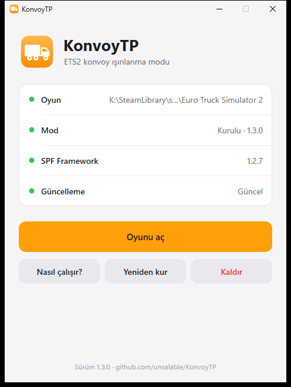

# KonvoyTP — ETS2 Konvoy Işınlanma Modu

Euro Truck Simulator 2'de konvoydayken **arkadaşının yanına tek tıkla ışınlan**, **onu yanına çek**,
kaza yapınca **yola çek** ya da **kendi şeridine geç**, devrilen kamyonu düzelt, kazadan önceki yere **geri sar**.
Oyun içinde **F8** ile açılan küçük, sade bir menü. **Shift+F8** menüyü açmadan seni yola çeker.

<p>
  
  
</p>

<sub>Soldaki: kurulum ve güncelleme uygulaması. Sağdaki: oyun içi menü (görüntü 1.1 sürümünden; Kurtar sekmesinin başında artık
<b>Yola çek</b> ve <b>Kendi şeridine geç</b> var).</sub>

---

## ⬇️ İndir ve kur (1 dakika)

1. **[KonvoyTP_Kurulum.exe dosyasını indir](https://github.com/unsalable/KonvoyTP/releases/latest/download/KonvoyTP_Kurulum.exe)**
2. Çift tıkla. Mavi "Windows bilgisayarınızı korudu" ekranı çıkarsa: **Ek bilgi → Yine de çalıştır**.
3. Açılan pencerede **Kur**'a bas. Oyun klasörünü kendisi bulur, gerekli **SPF Framework**'ü de kurar.
4. **Oyunu aç**, kamyona geç, **F8**'e bas. Bu kadar.

> Konvoyda ışınlanmak istediğin **herkesin** kurması gerekir (konumlar mod üzerinden paylaşılır).
> Kurulumdan sonra masaüstünde **KonvoyTP** kısayolu olur.

### Güncellemeler kendiliğinden gelir

- **KonvoyTP uygulamasını her açtığında** yeni sürüm var mı bakar; varsa kendini indirip günceller ve oyundaki modu da günceller
  (oyun açıksa, oyun kapanınca).
- **Oyun da her açılışta** modun yeni sürümü var mı bakar; varsa arka planda indirir, oyunu bir sonraki açışında yeni sürüm çalışır.
  (İstersen oyun içinden kapatabilirsin: Ayarlar → *Yeni sürümü otomatik indir*.)
- İndirilen her dosya, GitHub'ın verdiği SHA-256 özetiyle doğrulanır; tutmazsa kurulmaz.

**Kaldırmak için:** KonvoyTP uygulamasında **Kaldır** (ya da Windows Ayarlar → Uygulamalar → KonvoyTP).
Kayıtlı yerlerin masaüstüne yedeklenir; SPF Framework yerinde kalır.

---

## Ne yapar?

| Sekme | Buton | Ne olur |
|---|---|---|
| **Konvoy** | **Git** | Arkadaşının ~25 m arkasına, yolun üstüne, onun baktığı yöne ışınlanırsın |
| | **Getir** | Arkadaşını senin arkana çeker (izin verdiyse) |
| | **Herkesi yanıma topla** | İzin veren herkesi arkana dizer |
| **Kurtar** | **Yola çek** · `Shift+F8` | Yoldan çıktıysan, tarlaya uçtuysan, bir yere sıkıştıysan kamyonu en yakın yola, gittiğin yöne doğru koyar. Oyunun F7 → 2'si gibi, ama her yerde çalışır |
| | **Kendi şeridine geç** | Kazada karşı şeride düştüysen kamyonu kendi şeridine, doğru yöne bakacak şekilde geri alır |
| | **Kamyonu düzelt** | Devrildiysen kamyonu olduğun yerde tekerleklerinin üstüne, düz koyar |
| | **Son ışınlanmayı geri al** | Yanlışlıkla ışınlandıysan (ya da biri seni çektiyse) önceki yerine döner |
| | **Geri sar 10 sn · 30 sn · 1 dk · 3 dk** | Kazadan/uçuştan önce yolda düzgün gittiğin son noktaya döner |
| **Yerler** | **Kaydet / Git** | Bir yeri adıyla kaydet, sonra tek tıkla oraya dön; koordinata git |
| **Ayarlar** | | Görünen adın, seni kimin çekebileceği, tuşlar, otomatik güncelleme |

- **Akıllı kurtarma:** Mod, sen düzgün sürerken (dik, ileri giderken, kaymadan, asfaltta) geçtiğin yolu arka planda
  not eder. Kaza anlarını — savrulma, devrilme, havada uçma — kendisi anlar; o anları, hemen öncesini ve çim/toprak
  zemini yok sayar. Bu yüzden **Yola çek** ve **Kendi şeridine geç** kamyonu hep daha önce düzgün sürdüğün şeride
  koyar: çimene, tarlaya ya da çarptığın aracın üstüne değil.
- **Yönetici (admin):** konvoyu kuran kişi (host). Herkes Ayarlar'dan kimin kendisini çekebileceğini seçer:
  **Sadece host** (varsayılan) · **Herkes** · **Kimse**. "Git" ile herkes istediği arkadaşına gidebilir.
- **Hızlı:** yakın ışınlanmalar (yola çek, şerit, düzelt, kısa geri sar) **yükleme ekranı olmadan anında** olur.
- **Hafif:** menü kapalıyken menüyü hiç çizmez; konum mesajları sadece gerektiğinde gider.
- Menünün üstündeki nokta: **gri** tek başına · **sarı** konvoya bağlanıyor · **yeşil** konvoyda, bağlantı tamam · **kırmızı** sorun var.

---

## Sık sorulanlar

**Arkadaşım listede görünmüyor.**
İkinizde de **1.3.0 veya üstü** kurulu olmalı (eski sürümlerde konvoy bağlantısı düzgün çalışmıyordu; 1.3.0'da düzeltildi).
İkiniz de oyuna girdikten sonra mod birkaç saniyede bir kendiliğinden arar, liste kendiliğinden dolar.
Konvoy sekmesinde liste boşken altta **"Bağlantı: … gönderildi · … geri geldi · … arkadaştan geldi"** yazar:
"geri geldi" artıyor ama "arkadaştan geldi" 0 kalıyorsa arkadaşının modu çalışmıyordur — KonvoyTP uygulamasını açıp
**Mod: Kurulu** yazdığına baksın. Olmazsa ikinizin de
`...\Euro Truck Simulator 2\bin\win_x64\plugins\spfPlugins\KonvoyTP\logs\KonvoyTP.log` dosyasını paylaşın.

**Steam Atölyesi'nde (Workshop) neden yok?**
Atölye modları oyuna sadece *veri* (harita, kamyon, arayüz dosyaları) olarak bağlanır. KonvoyTP ise oyunun
`bin\win_x64\plugins` klasöründen yüklenen bir **eklenti (DLL)**; oyun Atölye'den gelen DLL'leri çalıştırmaz.

**Windows "bilgisayarınızı korudu" diyor / antivirüs uyarıyor.**
Uygulama imzalı değil (imza sertifikası ücretli), bu yüzden Windows ilk açılışta sorar: **Ek bilgi → Yine de çalıştır**.
Kaynak kodun tamamı bu sayfada; dosyaları kendin de derleyebilirsin (aşağıda).

**Modu olmayan arkadaşım sohbette "#KTP1 ..." yazıları görüyor?**
Konumlar konvoy sohbeti üzerinden gizli mesajlarla paylaşılır. Modu kurulu olanlar bunları görmez;
kurulu olmayanlar görür. Herkes kurunca sorun kalmaz.

**Menü F8 ile açılmıyor / Shift+F8 çalışmıyor.**
KonvoyTP uygulamasında **Mod: Kurulu** yazıyor mu bak; gerekirse **Yeniden kur**. Tuş başka bir şeyle çakışıyorsa:
oyun içinde Ayarlar → Menü tuşu (ya da Yola çek tuşu) → Değiştir.

**"Kendi şeridine geç" beni biraz geriye koydu?**
Bilerek: kamyon, kazadan bir an önce düzgün gittiğin noktaya konur ki çarptığın aracın üstüne düşmesin.

**Neden şehir listesi yok?**
Oyunda şehir merkezini yola oturtan bir fonksiyon yok; denendiğinde kamyon binaların üstüne düştü.
Bunun yerine bir buluşma noktasını **Yerler → Kaydet** ile kaydet; `yerler.txt` dosyasını arkadaşlarınla paylaşabilirsin.

**Hile/ban sorunu olur mu?**
Işınlanma, oyunun kendi `cheat teleport` komutuyla yapılır. Komut için geliştirici modu bir anlığına açılıp
otomatik kapanır. Resmi konvoy modu içindir; TruckersMP'de konvoy özellikleri kendiliğinden kapanır.

---

## Gereksinimler

- Windows 10 veya 11 (64-bit)
- Euro Truck Simulator 2 **1.62** (Steam)
- [SPF-Framework](https://github.com/TrackAndTruckDevs/SPF-Framework) **1.2.7** — uygulamanın içinde var, ayrıca kurman gerekmez

Oyun güncellenince menüde "kancalar YOK" görürsen, SPF-Framework'ün ve KonvoyTP'nin yeni sürümünü bekle.

---

## Kaynaktan derleme (geliştiriciler için)

Visual Studio 2022/2026 (C++ masaüstü iş yükü) gerekir.

```bat
build.bat                     :: build\out\KonvoyTP\KonvoyTP.dll ve build\out\app\KonvoyTP_Kurulum.exe
tests\run_tests.bat           :: oyunsuz mantık testleri (konvoy protokolü, izinler, iz, kaza algılama, güncelleyici)
powershell -ExecutionPolicy Bypass -File tests\test_app.ps1   :: uygulamanın kur / güncelle / kaldır testleri (sahte oyun klasöründe)
powershell -ExecutionPolicy Bypass -File paketle.ps1          :: dist\ (SPF'yi resmi sürümünden indirip doğrular)
```

**Nasıl çalışıyor:** [SPF-Framework](https://github.com/TrackAndTruckDevs/SPF-Framework) eklentisi.
Işınlanma oyunun `cheat teleport X;Y;Z;yön` komutuyla yapılır; oyunun ışınlanma fonksiyonu konvoyu
destekler (diğer oyuncular seni yeni yerinde görür). Yakın ışınlanmalarda oyunun yükleme ekranı çağrısı atlanır.
Arkadaş konumları konvoy sohbetine kancayla (`@@mp_chat_system@@` / `@@mp_chat_no_admin@@`) gönderilen gizli
`#KTP1 ...` satırlarıyla paylaşılır: satırlar oyunun kendi sohbet kutusu gibi (tür 0, herkese) ve ancak oyun sana
konvoy oyuncu kimliğini verdikten sonra gönderilir. "Yanına git/getir", "yola çek" ve "şeridine geç" noktaları,
oyuncuların gerçekten sürdüğü yoldan kaydedilen izden seçilir. Güncelleyici yalnızca Windows bileşenlerini kullanır
(WinHTTP + BCrypt SHA-256); uygulama Direct2D/DirectWrite ile çizilir ve modu, metinlerini ve SPF'yi içinde taşır.

---

## English (short)

KonvoyTP is an [SPF-Framework](https://github.com/TrackAndTruckDevs/SPF-Framework) plugin for Euro Truck Simulator 2
(1.62) Convoy mode: teleport to a friend, pull friends to you (host), get back on the road (**Shift+F8**, works where
the game's F7 recovery fails), back to your own lane after a crash, fix a flipped truck, rewind to the last good road
position, saved places. Press **F8** in game.
Install: download **[KonvoyTP_Kurulum.exe](https://github.com/unsalable/KonvoyTP/releases/latest/download/KonvoyTP_Kurulum.exe)**,
run it, click **Kur**. The app updates itself and the mod whenever you open it; the mod also downloads new versions at
game start (verified with GitHub's SHA-256). Not on Steam Workshop: Workshop items cannot load native plugins.

---

Lisans: [MIT](LICENSE). SPF-Framework © Track'n'Truck Devs, Apache 2.0.
Bu proje SCS Software ile bağlantılı değildir; Euro Truck Simulator 2, SCS Software'in ticari markasıdır.
