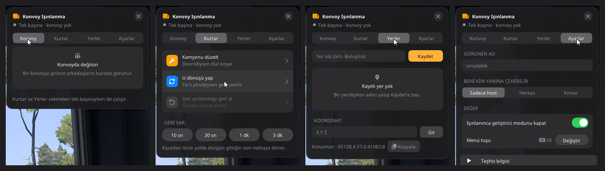

# KonvoyTP — ETS2 Konvoy Işınlanma Modu

Euro Truck Simulator 2'de konvoydayken **arkadaşının yanına tek tıkla ışınlan**, **onu yanına çek**,
**devrilen kamyonu düzelt**, **ters yöne girdiysen U dönüşü yap**, kazadan önceki yere **geri sar**.
Oyun içinde **F8** ile açılan küçük, sade bir menü.



---

## ⬇️ İndir ve kur (1 dakika)

1. **[KonvoyTP_Kurulum.zip dosyasını indir](https://github.com/unsalable/KonvoyTP/releases/latest/download/KonvoyTP_Kurulum.zip)**
2. Oyunu kapat. İndirdiğin zip'e sağ tıkla → **Tümünü ayıkla**.
3. Çıkan klasörde **`KUR.bat`** dosyasına çift tıkla.
   - Windows güvenlik uyarısı çıkarsa **Çalıştır**'a bas (mavi "Bilgisayarınız korundu" ekranında: **Ek bilgi → Yine de çalıştır**).
4. Oyunu aç, kamyona geç, **F8**'e bas. Bu kadar.

> Konvoyda ışınlanmak istediğin **herkesin** bu kurulumu yapması gerekir (konumlar mod üzerinden paylaşılır).
> Kurulum oyun klasörünü kendisi bulur, gerekli **SPF Framework**'ü de kurar; hiçbir dosyayı elle taşımana gerek yok.

**Kaldırmak için:** oyun kapalıyken aynı klasördeki **`KALDIR.bat`**.

---

## Ne yapar?

| Sekme | Buton | Ne olur |
|---|---|---|
| **Konvoy** | **Git** | Arkadaşının ~25 m arkasına, yolun üstüne, onun baktığı yöne ışınlanırsın |
| | **Getir** | Arkadaşını senin arkana çeker (izin verdiyse) |
| | **Herkesi yanıma topla** | İzin veren herkesi arkana dizer |
| **Kurtar** | **Kamyonu düzelt** | Devrildiysen kamyonu olduğun yerde tekerleklerinin üstüne, düz koyar |
| | **U dönüşü yap** | Ters yöne girdiysen kamyonu olduğun yerde geri yöne çevirir |
| | **Son ışınlanmayı geri al** | Yanlışlıkla ışınlandıysan (ya da biri seni çektiyse) önceki yerine döner |
| | **Geri sar 10 sn · 30 sn · 1 dk · 3 dk** | Kazadan/uçuştan önce yolda düzgün gittiğin son noktaya döner |
| **Yerler** | **Kaydet / Git** | Bir yeri adıyla kaydet, sonra tek tıkla oraya dön; koordinata git |
| **Ayarlar** | | Görünen adın, seni kimin çekebileceği, menü tuşu |

- **Yönetici (admin):** konvoyu kuran kişi (host). Herkes Ayarlar'dan kimin kendisini çekebileceğini seçer:
  **Sadece host** (varsayılan) · **Herkes** · **Kimse**. "Git" ile herkes istediği arkadaşına gidebilir.
- **Hızlı:** yakın ışınlanmalar (düzelt, U dönüşü, kısa geri sar) **yükleme ekranı olmadan anında** olur.
  Uzağa ışınlanırken oyun o bölgeyi yüklesin diye kısa bir yükleme ekranı çıkar (kamyon yerin içinden düşmesin diye).
- **Hafif:** menü kapalıyken hiçbir şey çizmez; konum mesajları sadece butona basınca gider.
- Menünün üstündeki nokta: **gri** tek başına · **yeşil** konvoyda, bağlantı tamam · **sarı** kontrol ediliyor · **kırmızı** sorun var.

---

## Sık sorulanlar

**Steam Atölyesi'nde (Workshop) neden yok?**
Atölye modları oyuna sadece *veri* (harita, kamyon, arayüz dosyaları) olarak bağlanır. KonvoyTP ise oyunun
`bin\win_x64\plugins` klasöründen yüklenen bir **eklenti (DLL)**; oyun Atölye'den gelen DLL'leri çalıştırmaz.
Bu yüzden dağıtım buradan, tek zip + `KUR.bat` ile yapılıyor.

**Modu olmayan arkadaşım sohbette "#KTP1 ..." yazıları görüyor?**
Konumlar konvoy sohbeti üzerinden gizli mesajlarla paylaşılır. Modu kurulu olanlar bunları görmez;
kurulu olmayanlar görür. Herkes kurunca sorun kalmaz.

**Menü F8 ile açılmıyor.**
`KUR.bat`'ı oyun kapalıyken tekrar çalıştır. Tuş başka bir şeyle çakışıyorsa: Ayarlar → Menü tuşu → Değiştir.

**Nokta kırmızı / arkadaş listesi boş.**
Arkadaşında da mod kurulu ve aynı konvoyda olmalı; Konvoy sekmesinde **Yenile**'ye bas.
Olmazsa Ayarlar → **Teşhis bilgisi** ekranının görüntüsünü ve
`...\Euro Truck Simulator 2\bin\win_x64\plugins\spfPlugins\KonvoyTP\logs\KonvoyTP.log` dosyasını paylaş.

**Neden şehir listesi yok?**
Oyunda şehir merkezini yola oturtan bir fonksiyon yok; denendiğinde kamyon binaların üstüne düştü.
Bunun yerine bir buluşma noktasını **Yerler → Kaydet** ile kaydet; `yerler.txt` dosyasını arkadaşlarınla paylaşabilirsin.

**Hile/ban sorunu olur mu?**
Işınlanma, oyunun kendi `cheat teleport` komutuyla yapılır. Komut için geliştirici modu bir anlığına açılıp
otomatik kapanır. Resmi konvoy modu içindir; TruckersMP gibi başka çok oyunculu sistemlerde kullanma.

---

## Gereksinimler

- Euro Truck Simulator 2 **1.62** (Steam, Windows 64-bit)
- [SPF-Framework](https://github.com/TrackAndTruckDevs/SPF-Framework) **1.2.7** — kurulum paketinde var, ayrıca kurman gerekmez

Oyun güncellenince menüde "kancalar YOK" görürsen, SPF-Framework'ün ve KonvoyTP'nin yeni sürümünü bekle.

---

## Kaynaktan derleme (geliştiriciler için)

Visual Studio 2022/2026 (C++ masaüstü iş yükü) gerekir.

```bat
build.bat                     :: build\out\KonvoyTP\KonvoyTP.dll
tests\run_tests.bat           :: oyunsuz mantık testleri (konvoy protokolü, izinler, iz/geri sar)
powershell -ExecutionPolicy Bypass -File paketle.ps1   :: dist\KonvoyTP_Kurulum.zip (SPF'yi kendisi indirir)
```

**Nasıl çalışıyor:** [SPF-Framework](https://github.com/TrackAndTruckDevs/SPF-Framework) eklentisi.
Işınlanma oyunun `cheat teleport X;Y;Z;yön` komutuyla yapılır; oyunun ışınlanma fonksiyonu konvoyu
destekler (diğer oyuncular seni yeni yerinde görür). Yakın ışınlanmalarda oyunun yükleme ekranı çağrısı
atlanır. Arkadaş konumları konvoy sohbetine kancayla (`@@mp_chat_system@@` / `@@mp_chat_no_admin@@`)
gönderilen gizli `#KTP1 ...` satırlarıyla paylaşılır; "yanına git/getir" noktaları, oyuncuların gerçekten
sürdüğü yoldan kaydedilen izden seçildiği için araç her zaman yolun üstüne iner.

---

## English (short)

KonvoyTP is an [SPF-Framework](https://github.com/TrackAndTruckDevs/SPF-Framework) plugin for Euro Truck Simulator 2
(1.62) Convoy mode: teleport to a friend, pull friends to you (host), fix a flipped truck, U-turn, rewind to the last
good road position, saved places. Press **F8** in game.
Install: download **[KonvoyTP_Kurulum.zip](https://github.com/unsalable/KonvoyTP/releases/latest/download/KonvoyTP_Kurulum.zip)**,
extract, close the game, run **`KUR.bat`**. Not available on Steam Workshop because Workshop items cannot load native plugins.

---

Lisans: [MIT](LICENSE). SPF-Framework © Track'n'Truck Devs, Apache 2.0.
Bu proje SCS Software ile bağlantılı değildir; Euro Truck Simulator 2, SCS Software'in ticari markasıdır.
